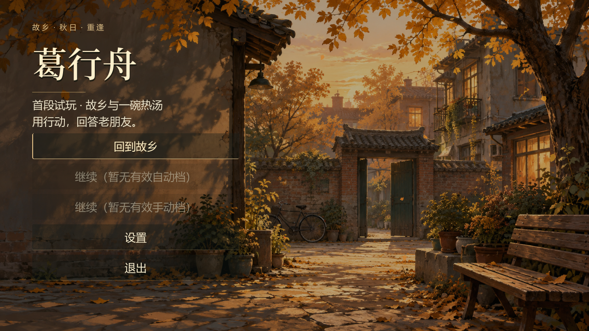
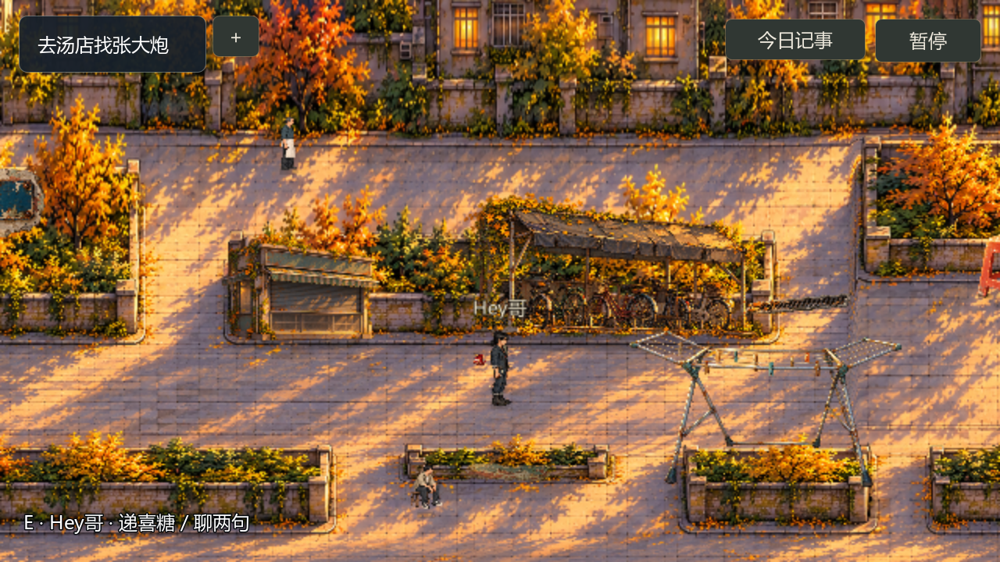
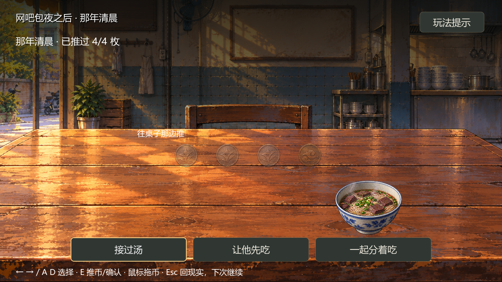

# 葛行舟 · 故乡与一碗热汤

> 2D 叙事探索短篇 · Godot 4.7.2 / C# · 可运行首段试玩

回到搬迁后的故乡，接到老朋友的结婚邀请。帮他递一份喜糖，再去熟悉的汤店坐一会儿。
一碗热汤、几枚硬币，让过去与眼前的人重新接上了话。

本作关注的不是选出“正确答案”，而是**玩家怎样用行动回应一段关系**。



## 🎮 下载试玩

本轮更新时间：**2026-10-17 22:02:41（北京时间，UTC+8）**。入口、人物与秋日菜单精修版已发布为试玩预览。

- **[下载最新版 Windows x64 试玩 ZIP（约 154 MiB）](https://github.com/anglelove3/gexingzhou-game/releases/download/vs01-feedback-20261017/gexingzhou-demo-vs01-feedback-20261017-win64.zip)** · [发行说明 / SHA256 / 已知问题](https://github.com/anglelove3/gexingzhou-game/releases/tag/vs01-feedback-20261017)
- 完整解压后，双击 `gexingzhou-demo.exe`。无需克隆源码、安装 Godot 或 .NET SDK；EXE、PCK 和 `data_GeXingzhou_windows_x86_64` 文件夹须保持一起，不要只复制 EXE，也不要在压缩软件内直接运行。
- [10月17日17:28上一轮试玩](https://github.com/anglelove3/gexingzhou-game/releases/tag/vs01-hr-20261017)和[10月14日历史旧版](https://github.com/anglelove3/gexingzhou-game/releases/tag/vs01)保留，不包含本轮入口/步态/菜单精修。
- 试玩范围：小区见面 → 街区递喜糖 → 汤店行动对白 → 硬币回忆 → 明天的伴郎约定。不是完整多日游戏。
- 建议为首次阅读与探索预留 10–15 分钟；这是体验安排建议，不是实测通关时长。不设探索倒计时。

## 这段游戏值得体验什么

### 用行动回答，而不只是选一句话

朋友问“最近怎么样”，可以先喝汤、替他摆好筷子，或看一眼旧手机。
三种动作有对应的姿态与对白。选择表达当下状态，不按“懂事程度”打分。

### 回忆是一件亲手做的事

在那年清晨的桌边，把四枚硬币逐一推过去；鼠标拖动和键盘都可操作。
随后选择接过汤、让对方先吃，或一起分着吃。回到现实后，朋友的回应会呼应这个动作。
中途离开、读档和重看都保留明确边界：重看不会改写第一次完成的经历。

### 有目的地，也可以绕一段路

安置小区、便利店街和汤店均可四向探索，带脚底碰撞、遮挡和就近互动。
沿主街可以推进故事，也可以看看旧门牌、报刊亭、落叶排水沟和晾晒架。
十三项可选见闻不会变成必须找齐的清单，不附加奖励或主线门槛。

本轮改善人物成年比例和居民迈步、小区近景构图，路口沿道路区域响应E；菜单采用随包思源宋体与秋日飘叶，支持减少动效。更新证据与发行状态见[本轮验收](docs/development/21_试玩反馈操作与表现精修验收.md)。





### 今日记事记下的是你真的经历过的事

记事分为当前目标、已完成经历和已发现见闻。没有看过的物件不会提前写进去。
收尾也只回顾实际完成的事情；记录由现有进度生成，不另外维护一套容易错位的任务状态。

## 操作速查

| 场合 | 操作 |
|---|---|
| 探索 | WASD / 方向键移动，Shift 加快；靠近后 E 互动 |
| 对白与选项 | E / Enter 继续；方向键选择、Enter 确认；Esc 退出当前阅读 |
| 手机 | Tab 打开或收起；来电时 Enter 接听 |
| 今日记事 | 自由走动时 J 打开；滚轮 / PgUp / PgDn 翻阅，J / Esc 收起 |
| 找路 | 点目标卡的 +，或在今日记事“当前”页查看位置提示 |
| 坐下与回忆 | 桌边 E；坐下后 Esc 起身；硬币可拖动，或左右选币、E 推币 |
| 保存与退出 | F5 手动保存、F9 读取；关闭界面并起身后 Esc 暂停，可保存退出 |

暂停菜单里的“操作与试玩提示”可反复查看。支持 20–32 字号、字幕速度、减少动效及分组音量设置；静音不影响剧情推进。

## 设计与实现

- **叙事结构**：将邀请、递糖、同桌行动和回忆串成可完整结束的短篇；三种回忆回应通向相同的后续约定，不伪装成多结局。
- **探索呈现**：Godot 静态具名场景，四向移动与脚底碰撞；地图视觉、遮挡、互动距离及座位动作分开处理。
- **内容与规则分离**：JSON 保存对白和参数，纯 C# Domain 层处理剧情规则，Godot / C# 负责场景与界面。
- **重复操作安全**：完成事实与交互 ID 去重；重读见闻、重看回忆和重复付款不会重复结算。
- **存档保护**：自动 / 手动槽、备份和版本识别；旧版经明确确认复制升级，开始新游戏先保留副本，不提示用户直接删档。
- **验证方式**：领域规则回归、Godot 自动流程、真实渲染截图及独立发行包检查。测试数量与本轮限制见验收记录，不用自动化数字代替真人体验结论。

与另一个项目 [《开始懂了》（fangguoge-game）](https://github.com/anglelove3/fangguoge-game) 相比，本作更集中展示**空间探索、行动式对白与物件回忆**；两作各自维护，不共用存档。

## 开发与仓库导览

开发需要 Godot **4.7.2 .NET 版**和 .NET SDK 8；普通 Godot 版不能运行 C#。玩家下载发行包不需要编辑器。

```powershell
dotnet build GeXingzhou.csproj
dotnet run --project tests/DomainChecks
powershell -NoProfile -File tools/verify.ps1 -GodotExe '你的 Godot .NET 控制台程序路径'
```

构建完成后，在 Godot 打开 `project.godot`，F5 运行。

- `content/vs01/`：手工可编辑的对白、参数及场景配置。
- `code/Domain/`：剧情、记事投影、移动和存档规则。
- `scenes/`、`scripts/`：可编辑世界、角色、界面与表现控制。
- `tests/`、`tools/`：规则测试、引擎回归、画面捕获和交付检查。
- [更新日志](docs/development/10_更新日志.md)：各轮北京时间、更新内容和验收边界。
- [协作与接续入口](00_阅读与协作说明.md)：开发接续，不需要玩家阅读。

## 制作说明与当前边界

项目以创作者的故事方向、人物设定与体验取舍为基础，采用 AI 协作进行编程和测试迭代，美术使用生成式工具辅助制作。素材来源、处理记录与许可边界保存在 [资源清单](assets/manifest.json) 和 [licenses](licenses/) 中；不将生成图称为纯手绘像素终稿。音乐、环境与动作音效为项目内程序合成，无真人配音。

当前提供首段叙事探索，不包含完整多日时段经营、楼层探索、自由编辑日记、联网聊天或移动端版本。公开仓库不包含私人原稿、现实照片、真实玩家存档或本机配置；公开素材不等于已完成商业发行权利审查。

试玩预览仍有退出时的 ObjectDB / resources 释放警告待查；本机启动及受控剧情流程检查通过，不等于其它显卡、纯净电脑或真人声音与阅读节奏均已验收。详细证据与限制见[本轮验收记录](docs/development/21_试玩反馈操作与表现精修验收.md)。

历史首页已归档至[开发记录](docs/development/18_历史首页归档.md)，不再把多轮历史接续堆在试玩入口之前。
